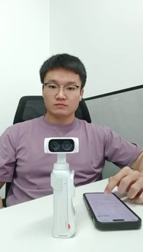

# AirLuna · 用 AirPods Pro 控制云台

佩戴 AirPods Pro，校准正前方，再转动头部。AirLuna 的独立 iOS App 读取耳机姿态，将相对偏航和俯仰转换为 Insta360 Luna Ultra 云台的无线控制指令。这是受官方头追模块启发的个人原型。

[](media/1.mp4)

[观看实机演示 · 24 秒](media/1.mp4)

## 一次转头如何传到云台

1. [HeadphoneMotionService](App/HeadphoneMotionService.swift) 通过 Core Motion 接收 AirPods Pro 的四元数姿态。
2. [PoseMath](Shared/PoseMath.swift) 以校准时的朝向为零点计算偏航和俯仰。[GimbalController](Shared/GimbalController.swift) 对动作应用死区、平滑与限幅。
3. [LunaSession](App/LunaSession.swift) 通过局域网发送命令。随附的[方向命令配置](App/ProtocolProfile.json)对应演示设备固件 1.0.288，包含上下左右及停止命令，其他固件的兼容性有待实机验证。

## 运行

在 macOS 下可先验证控制算法，无需连接耳机或云台。

```sh
swift run AirLunaCoreSelfCheck
```

真机体验需要支持头部运动数据的 AirPods Pro、iPhone 和兼容的 Luna Ultra。在 Xcode 打开 `AirLunaHeadControl.xcodeproj`，选择自己的签名团队和 Bundle ID，安装后授权运动与本地网络访问。首次联机先让云台四周留有空间，校准零位，再用小幅动作确认方向。
